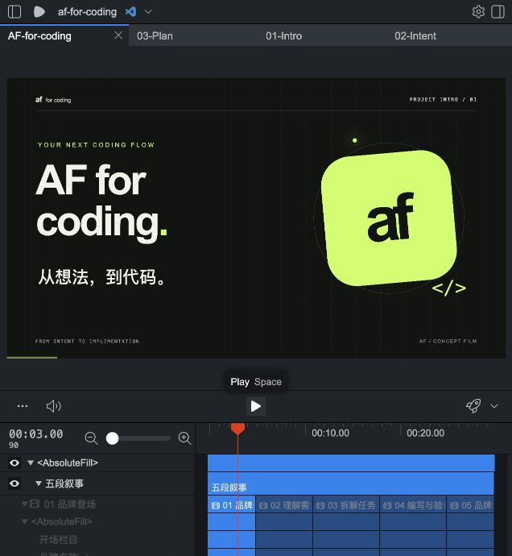

# AF for coding

**从想法，到代码。把想法，写成现实。**

一个使用 Remotion、React 和 TypeScript 制作的 30 秒中文项目介绍视频。通过五段动态分镜，呈现 AI 编程协作的概念流程：理解需求、拆解任务、编写代码与验证结果。

> 本仓库是视频创作项目。片中的 AF for coding 为概念品牌，功能和代码画面用于叙事演示，不代表已上线的 AI 编程产品。



## 视频规格

| 项目 | 内容                                               |
| ---- | -------------------------------------------------- |
| 时长 | 30 秒 / 900 帧                                     |
| 画面 | 1920 × 1080，16:9                                  |
| 帧率 | 30 fps                                             |
| 视觉 | 石墨黑、暖白、荧光绿；大字排版、代码动效、任务连线 |
| 音频 | 原创程序合成电子配乐，无旁白                       |
| 编辑 | 完整主时间线与五个独立场景                         |
| 导出 | H.264 MP4，包含配乐                                |

## 快速开始

使用 Node.js 22.13 或更高的 22.x 版本，以及 npm。仓库中的 `.nvmrc` 固定为本项目已验证的 Node.js 22.23.2；使用 nvm 时可先运行 `nvm install` 和 `nvm use`。

下载或克隆本仓库后，在项目根目录运行：

```sh
npm ci
npm run dev
```

在 Remotion Studio 中选择 **AF-for-coding**，点击播放或按空格。`Scenes` 文件夹包含五个可单独预览和编辑的场景。

## 导出 MP4

```sh
npm run render
```

输出文件为 `out/AF-for-coding.mp4`。首次渲染可能需要联网下载 Remotion 渲染浏览器。

指定其他输出位置：

```sh
npx remotion render src/index.ts AF-for-coding /absolute/path/AF-for-coding.mp4 --codec=h264
```

也可以在 Studio 点击 **Render**，选择 H.264 并设置输出路径。

## 分镜

| 时间    | 主题       | 主文案                   | 动画                         |
| ------- | ---------- | ------------------------ | ---------------------------- |
| 00–05 s | 品牌登场   | 从想法，到代码。         | AF 字标入场、轨道运动        |
| 05–11 s | 理解需求   | 说出目标，理清方向。     | 逐字输入需求、依次提炼标签   |
| 11–18 s | 拆解任务   | 复杂任务，步步有解。     | 理解 → 规划 → 实现，节点展开 |
| 18–25 s | 编写与验证 | 写得出来，也经得起验证。 | 代码出现、差异高亮、检查完成 |
| 25–30 s | 品牌收尾   | 把想法，写成现实。       | 绿色全屏、箭头与品牌主张     |

## 项目结构

```text
src/
  index.ts           # Remotion 入口
  Root.tsx           # 主影片与独立场景注册
  Composition.tsx    # 30 秒时间线、配乐、进度条
  Scenes.tsx         # 五段动画与可编辑组件
public/
  signal.wav         # 原创合成配乐
scripts/
  make-audio.py      # 配乐生成脚本（Python 标准库）
preview.jpg          # Studio 预览截图
remotion.config.ts   # 渲染与预览配置
```

## 修改与检查

- **改文案和样式**：编辑 `src/Scenes.tsx`，或使用 Studio 支持的 Interactive 控件。
- **改场景时长**：编辑 `src/Composition.tsx` 的时间边界，并同步 `src/Root.tsx` 的总时长和独立场景注册。
- **改配乐**：替换 `public/signal.wav`；或执行 `python3 scripts/make-audio.py` 重新生成。
- **改尺寸和帧率**：编辑 `src/Root.tsx`，并复查布局和动画节奏。

背景网格、轨道、逐字显示和进度条含程序化计算；这些细节需在源码中调整。字体使用系统 Arial / PingFang SC / Microsoft YaHei，跨平台字形可能略有差异。

```sh
npm run lint    # ESLint 与 TypeScript 检查
npm run build   # 生成 Remotion bundle，不导出视频
```

`node_modules/`、`build/` 和 `out/` 不提交到仓库。配乐文件及其生成脚本均随源码提供。

## 技术与授权

- Remotion 4.0.543
- React 19.3.1
- TypeScript 5.9

本项目当前保持 `UNLICENSED`，尚未授予开源许可证。Remotion 及其他依赖适用各自的授权条款。
